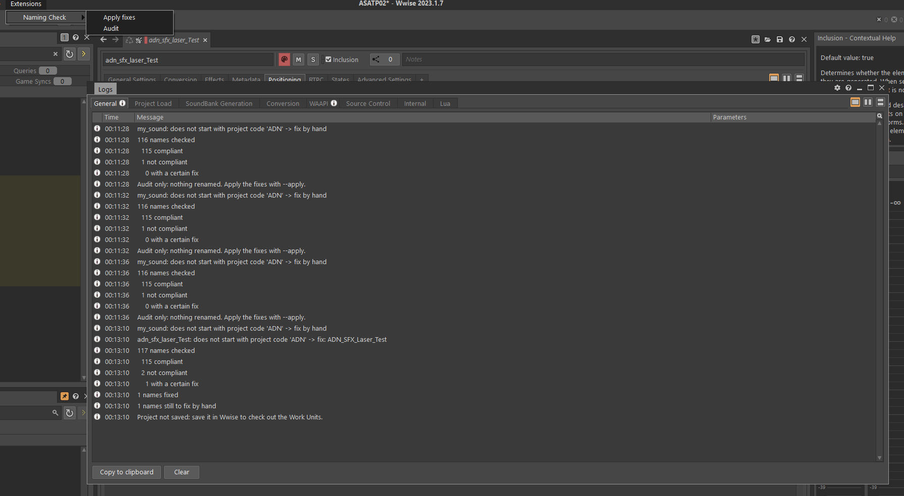

# Naming Check

Keep the names of your Wwise project consistent without checking them by hand.
Naming Check audits every SFX Sound and Music Track against your project's own
naming convention, then fixes the unambiguous mistakes in one undoable step. It
adds an **Extensions > Naming Check** menu to Wwise.

**Who it is for:** audio designers, technical sound designers and audio
programmers working in Wwise, especially in teams where several people name
objects and the project is shared through Perforce or SVN. Python is only needed
to run the script; no coding is required to use the menu.



Audits the names of the SFX Sounds and Music Tracks of the Wwise project
currently open against that project's own naming convention, through the Wwise
Authoring API (WAAPI).

A compliant name is `<project>_<type>_<Category>[_anything]`, e.g.
`ADN_SFX_Laser_PassBy_04`:

- `project`: the project code, exactly as set in the convention file (letters and
  digits only, like every type).
- `type`: one of the types listed in the convention file (e.g. `SFX`, `AMB`, `MUS`).
- `Category`: a free word in CamelCase (uppercase letter, then letters and
  digits), e.g. `Laser`, `RatsScream`.
- Anything after the category (`_PassBy_04`, `_04`, `_02_Mono`) is not checked.

Voice Sounds are ignored.

## Add Naming Check to a Wwise project

1. On every machine, once: install Python 3.10 or later (tick "Add python.exe to
   PATH"), then run `python -m pip install waapi-client`.
2. Copy into the Wwise project folder (the one holding the `.wproj`):
   - `naming_check.py` into a `script` folder,
   - `Add-ons\Commands\naming_check.json` into an `Add-ons\Commands` folder.

   ```
   MyGame\
   |-- MyGame.wproj
   |-- script\
   |   `-- naming_check.py
   `-- Add-ons\
       `-- Commands\
           `-- naming_check.json
   ```
3. In Wwise, enable WAAPI (Project > User Preferences > Enable Wwise Authoring
   API), then restart Wwise and open the project.
4. Run **Extensions > Naming Check > Audit**. The first time, the Logs view shows
   the path of the new `script\naming_convention.ini`: fill it in, then run
   **Audit** again.
5. Submit `script\` and `Add-ons\` with the project: teammates get the menu and
   the convention when they sync.

The two commands run on the whole project and print their report in the Logs
view (Views > Logs): **Audit** changes nothing, **Apply fixes** applies the
certain fixes (see below).

## Requirements

- Wwise 2021.1 or later (WAQL), with WAAPI enabled
  (Project > User Preferences > Enable Wwise Authoring API).
- Python 3.10 or later.

## Install

```
python -m venv .venv
.venv\Scripts\python -m pip install -r requirements.txt
```

## Usage

Open the project in Wwise, then:

```
.venv\Scripts\python naming_check.py
```

On first use, the script creates `script\naming_convention.ini` in the Wwise
project folder, prints its path and stops. Open it, replace every `CHANGE_ME`
following the comments, save, and run the script again. The file belongs to the
Wwise project: submit it with the project so the whole team shares the convention.

The script lists every non-compliant name with the first rule it breaks and, when
it can be deduced with certainty, the fix. It changes nothing in the project.
Review the fixes, then apply them:

```
.venv\Scripts\python naming_check.py --apply
```

Certain fixes, combined when needed:

| Mistake | Before | After |
|---|---|---|
| Missing project code | `SFX_Laser_PassBy_04` | `ADN_SFX_Laser_PassBy_04` |
| Project or type case | `adn_sfx_Laser_PassBy_04` | `ADN_SFX_Laser_PassBy_04` |
| Space or dash instead of `_` | `ADN SFX-Laser_PassBy 04` | `ADN_SFX_Laser_PassBy_04` |
| Category not CamelCase | `ADN_SFX_laser_PassBy_04` | `ADN_SFX_Laser_PassBy_04` |
| Music Track missing project and type | `Battle_Intro_01` | `ADN_MUS_Battle_Intro_01` |

The music type comes from the `music_type` setting. A Sound missing both its
project and type is not fixed: the script cannot choose between e.g. `SFX` and
`AMB`.

Anything else is listed to fix by hand, in particular:

- names missing a part that cannot be deduced (`my_sound`);
- a space or dash right after the category, with no `_` around it: in
  `ADN_SFX_Rats Scream_Death_02` or `ADN_SFX_Laser-PassBy_04` the script cannot
  tell whether `Rats Scream` / `Laser-PassBy` is one category or a category
  followed by the rest of the name;
- doubled, leading or trailing `_` (`ADN__SFX_Laser_PassBy`, `_SFX_Laser_PassBy`).

With `--apply`:

- All fixes form a single undo group: one Ctrl+Z (Edit > Undo Naming Check fixes)
  in Wwise reverts them.
- A rejected fix (e.g. a sibling already has the new name) is listed and the batch
  continues.
- The project is not saved. Save it in Wwise so that its Perforce/SVN plugin checks
  out the modified Work Units, then submit.

Options:

- `--url`: WAAPI WebSocket URL, default `ws://127.0.0.1:8080/waapi`.
- `--apply`: rename the objects whose fix is certain.

Exit codes: `0` every name is compliant (after the fixes with `--apply`), `1` some
names still need a fix, `2` error (Wwise unreachable, request rejected, convention
file missing or incomplete).

## Tests

The Wwise tests start a headless `WwiseConsole waapi-server` on a temporary project
(ports 8095/8096), so an open Wwise is not affected. They are skipped when
`WwiseConsole.exe` is not found; set `WWISE_CONSOLE` to its path if Wwise is not
installed in the default 2024.1.4.8780 location. The convention file tests need no
Wwise.

```
.venv\Scripts\python -m unittest -v
```

## Checks

```
.venv\Scripts\python -m pip install -r requirements-dev.txt
.venv\Scripts\ruff format --check .
.venv\Scripts\ruff check .
.venv\Scripts\mypy naming_check.py test_naming_check.py test_convention.py
```

`waapi-client` ships no type annotations, so `pyproject.toml` tells mypy to treat
the `waapi` module as untyped: calls into it are not type-checked.

## License

MIT, Copyright (c) 2026 Kevin PANCHOUT. See [LICENSE](LICENSE).
